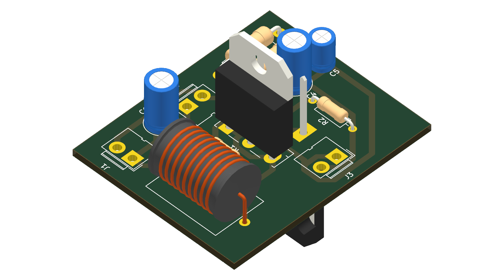
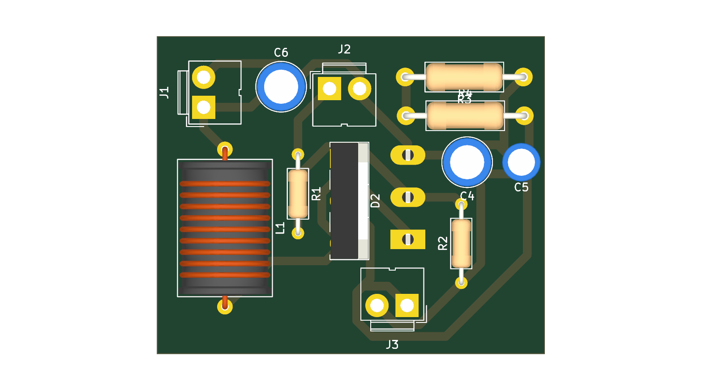

# Non-Isolated Boost DC-DC Converter
### Discrete Hardware Design • KiCad PCB • LTspice Simulation

[](https://www.kicad.org/)
[](https://www.analog.com/en/resources/design-tools-and-calculators/ltspice-simulator.html)
[](./LICENSE)
[](https://github.com/abhishek-rath125)
[](https://www.nitgoa.ac.in/)

A high-performance, non-isolated boost (step-up) DC-DC converter designed from discrete power semiconductor and passive components. This repository contains the complete engineering workflow: **theoretical mathematical derivations**, **LTspice SPICE simulation models** (for both CCM and DCM analysis), **KiCad 10 schematic & 2-layer PCB layout**, and **manufacturing Gerbers** for physical lab fabrication.

Developed and validated by **Abhishek Rathour** for **EE306 Tinkering Lab II** in the Department of Electrical & Electronics Engineering at the **National Institute of Technology Goa (NIT Goa)**.

---

## 📸 Hardware Previews

| 3D Isometric View | 3D Top View |
|:---:|:---:|
|  |  |

| 2D PCB Routing & Silkscreen Layout | Schematic PDF Export |
|:---:|:---:|
|  | [📄 Download Schematic PDF](docs/boost_converter_schematic.pdf) |

---

## ⚡ Specifications

| Parameter | Laboratory Target / Measured Value | Notes |
|---|---|---|
| **Converter Topology** | Non-isolated Boost (Step-up), Open-Loop | Discrete power stage |
| **Input Voltage ($V_{in}$)** | **12.0 V DC** | Stable DC bench supply |
| **Output Voltage ($V_{out}$)** | **13.0 V – 24.0 V DC** | Regulated via PWM duty cycle ($D$) |
| **Switching Frequency ($f_{sw}$)** | **20 kHz** ($T_{sw} = 50\,\mu\text{s}$) | Optimized for discrete inductor & switching loss |
| **Measured Efficiency ($\eta$)** | **~91 %** | Measured across nominal operating range |
| **Gate Drive** | External PWM / 555-Timer Generator | $V_{GS} = 0 - 12\,\text{V}$ switching levels |
| **Conduction Modes** | CCM ($R_{load} = 100\,\Omega$) / DCM ($R_{load} = 200\,\Omega$) | Mode verified in simulation & lab hardware |

---

## 🛠️ Key Components & Bill of Materials (BOM)

| Ref Des | Component | Value / Part Number | Description / Package |
|---|---|---|---|
| **$L_1$** | Power Inductor | **$319\,\mu\text{H}$** | Hand-wound toroidal iron-powder core, $R_{ser} \approx 30\,\text{m}\Omega$ |
| **$Q_1$** | Power MOSFET | **IRFZ44N** | N-Channel, $55\,\text{V}$, $49\,\text{A}$, $R_{DS(on)} = 17.5\,\text{m}\Omega$, TO-220 |
| **$D_2$** | Schottky Diode | **MBRF20100SCT** | Dual Schottky barrier, $100\,\text{V}$, $20\,\text{A}$, low $V_F \approx 0.55\,\text{V}$, TO-220F |
| **$C_4, C_6$** | Bulk Capacitors | **$220\,\mu\text{F}$** | Radial electrolytic, low ESR, $50\,\text{V}$ rated |
| **$C_5$** | Decoupling Cap | **$3\,\mu\text{F}$** | High-frequency film/ceramic bypass for output ripple suppression |
| **$R_1$** | Gate Resistor | **$47\,\Omega$** | Damps gate ringing and limits peak gate drive inrush current |
| **$R_2$** | Gate Pull-Down | **$10\,\text{k}\Omega$** | Ensures MOSFET remains off during float/initial power-up |
| **$R_3, R_4$** | Dummy Load | **$200\,\Omega$ each** | Wirewound ceramic power resistors (parallel = $100\,\Omega$) |
| **$J_1, J_2, J_3$** | Terminal Blocks | **2-Pin Connectors** | Screw terminal connections for Input, PWM Gate In, and Load |

---

## 📐 Circuit Theory & Mathematical Derivations

### 1. Steady-State Conversion Ratio (Continuous Conduction Mode)
Applying Faraday's Law of Induction and the inductor volt-second balance over one complete period $T_{sw}$:

$$\int_0^{T_{sw}} v_L(t) \, dt = 0$$

- **During Switch ON interval ($0 \le t \le D T_{sw}$):**  
  The MOSFET conducts. Diode $D_2$ is reverse-biased.
  $$v_L = V_{in}$$

- **During Switch OFF interval ($D T_{sw} \le t \le T_{sw}$):**  
  The MOSFET turns off. The inductor voltage flies up, forward-biasing $D_2$.
  $$v_L = V_{in} - V_{out}$$

Equating the net volt-seconds to zero:
$$V_{in} \cdot D \cdot T_{sw} + (V_{in} - V_{out}) \cdot (1 - D) \cdot T_{sw} = 0$$

$$V_{out} = \frac{V_{in}}{1 - D}$$

### 2. Inductor Current Ripple & Critical Inductance
The peak-to-peak inductor current ripple $\Delta I_L$ is:

$$\Delta I_L = \frac{V_{in} \cdot D}{f_{sw} \cdot L_1}$$

For $V_{in} = 12\,\text{V}$, $D = 0.40$, $f_{sw} = 20\,\text{kHz}$, and $L = 319\,\mu\text{H}$:
$$\Delta I_L = \frac{12 \times 0.40}{20\,000 \times 319 \times 10^{-6}} \approx 0.752\,\text{A}$$

The critical boundary inductance $L_{crit}$ between Continuous Conduction Mode (CCM) and Discontinuous Conduction Mode (DCM):

$$L_{crit} = \frac{R_{load} \cdot D (1 - D)^2}{2 \cdot f_{sw}}$$

- **At $R_{load} = 100\,\Omega$ ($R_3 \parallel R_4$):**  
  $L_{crit} = \frac{100 \times 0.4 \times (0.6)^2}{40\,000} = 360\,\mu\text{H} \approx 319\,\mu\text{H}$  
  The converter operates in continuous conduction with slight ripple margin.
- **At $R_{load} = 200\,\Omega$ (Single $R_3$ active):**  
  $L_{crit} = 720\,\mu\text{H} > 319\,\mu\text{H}$  
  The inductor fully discharges every cycle, shifting the converter into **Discontinuous Conduction Mode (DCM)**.

---

## 🧪 Simulation & Experimental Validation

### Simulation vs. Measurement Agreement
- **LTspice SPICE simulation models** agreed with lab bench measurements within **1 % error margin**.
- Confirmed that conduction mode (CCM vs DCM), not just duty cycle $D$, dictates the conversion ratio of an open-loop boost stage.
- Thermal rating and heat sink sizing of the dummy load resistor and power semiconductor packages are critical factors for sustained operation.

### LTspice Models
The [`ltspice/`](ltspice/) directory includes two validated models:
1. **`boost_converter_open_loop.asc`**: Parameterized duty cycle and stepped load analysis.
2. **`boost_converter_555_pwm.asc`**: Hardware-accurate gate drive generation using an NE555 timer IC.

Refer to [`ltspice/README.md`](ltspice/README.md) for step-by-step instructions and probe setup.

---

## 📁 Repository Layout

```
boost-converter-kicad-ltspice-hardware/
├── README.md                          # Comprehensive project documentation
├── LICENSE                            # MIT License
├── .gitignore                         # KiCad & LTspice gitignore rules
├── hardware/                          # KiCad PCB design files
│   ├── buckboostf.kicad_pro           # KiCad project file
│   ├── buckboostf.kicad_sch           # Schematic sheet with title block
│   ├── buckboostf.kicad_pcb           # 2-layer PCB layout
│   └── gerbers/                       # Fabrication files (RS-274X & Excellon)
│       ├── buckboostf-F_Cu.gbr        # Top copper layer
│       ├── buckboostf-B_Cu.gbr        # Bottom copper layer
│       ├── buckboostf-F_Mask.gbr      # Top solder mask
│       ├── buckboostf-B_Mask.gbr      # Bottom solder mask
│       ├── buckboostf-F_Silkscreen.gbr# Top silkscreen legend
│       ├── buckboostf-Edge_Cuts.gbr   # Board contour outline
│       ├── buckboostf-PTH.drl         # Plated through holes
│       └── buckboostf-job.gbrjob      # KiCad Gerber job description
├── ltspice/                           # SPICE simulation workspace
│   ├── boost_converter_open_loop.asc  # Open-loop boost simulation model
│   ├── boost_converter_555_pwm.asc    # 555-timer PWM driven boost model
│   └── README.md                      # Detailed LTspice simulation guide
└── docs/                              # Visual assets & schematics
    ├── boost_converter_schematic.pdf  # Schematic print (PDF)
    ├── 3d_render_top.png              # Top-down 3D PCB render
    ├── 3d_render_isometric.png        # Isometric 3D PCB render
    └── buckboostf.png                 # PCB layout preview
```

---

## 🚀 Getting Started

### 1. Inspecting & Fabricating the PCB (KiCad)
1. Open [`hardware/buckboostf.kicad_pro`](hardware/buckboostf.kicad_pro) in **KiCad 8.0, 9.0, or 10.0+**.
2. View the schematic in Eeschema and PCB layout in Pcbnew.
3. The manufacturing gerbers are pre-generated in [`hardware/gerbers/`](hardware/gerbers/). You can zip this directory and upload directly to JLCPCB, PCBWay, or OSH Park (standard 2-layer, 1.6 mm FR-4, 1 oz copper).

### 2. Running LTspice Simulations
1. Install [LTspice](https://www.analog.com/en/resources/design-tools-and-calculators/ltspice-simulator.html).
2. Open [`ltspice/boost_converter_open_loop.asc`](ltspice/boost_converter_open_loop.asc).
3. Click **Run** (`Alt + S`) to simulate.
4. Probe `V(vout)` and `I(L1)` to observe steady-state operation and ripple characteristics.

---

## 👨‍💻 Author & Authorizations

**Abhishek Rathour**  
*Undergraduate Student, Electrical and Electronics Engineering (EEE)*  
**National Institute of Technology Goa (NIT Goa)**

- 🌐 **GitHub**: [@abhishek-rath125](https://github.com/abhishek-rath125)
- 💼 **LinkedIn**: [in/abhishek-rathour-94b89434b](https://www.linkedin.com/in/abhishek-rathour-94b89434b/)
- 📧 **Email**: abhishekrathour426@gmail.com

---

## 📄 License
This project is open-source hardware and software licensed under the [MIT License](LICENSE).
